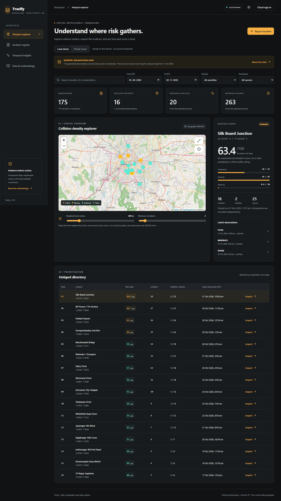

# Tracify

**An explainable road-safety analytics application with geographic hotspot detection, persistent incident reporting, and a synthetic Bengaluru demonstration.**

Tracify groups incident coordinates with DBSCAN, ranks the resulting
clusters with a transparent risk index, and shows the records behind every
result. It runs locally without accounts or API keys. Optional Firebase mode
provides a private, authenticated cloud workspace.

The included incidents are **synthetic**. The application is an exploratory
analysis tool, not an official traffic feed, crash-probability model, or
emergency service.



## Run locally

Install Node.js **24 LTS** (minimum 22.12), then run these commands from the
project root:

```sh
npm ci
npm run dev
```

Open [localhost:3000](http://localhost:3000). No `.env` file, Firebase account,
Google Maps key, Gemini key or Java backend is required for the demo.

The first visit seeds 175 synthetic observations into this browser's
IndexedDB. Reports, imports and attachments persist across reloads. Data stays
on this device until exported or deleted; clearing site data removes it.
Charts default to the last 90 calendar days in IST. To reproduce the sample
snapshot, select **3 August 2026 through 31 October 2026**.

For a production build:

```sh
npm run build
npm run preview
```

`dist/` is the static deployable application. The map baselayer and optional
web fonts require internet; the directory, calculations, reports and incident
overlays still work if external tiles fail. This is not an offline-installable
PWA and does not cache basemap tiles.

## What is implemented

- Geographic DBSCAN with haversine distance in meters, adjustable neighborhood
  radius and minimum count, and explicit noise observations.
- Linked map, selected-cluster profile, ranked directory and source records.
- Date, text, severity and provenance filters shared by all analytics views.
- Risk-score component breakdown and timestamp-based recency.
- Persistent incident reports with optional JPEG, PNG, WebP, MP4 or WebM evidence
  up to 5 MiB.
- Atomic CSV import with preview, row errors, source attribution, duplicate-ID
  handling and capacity limits; filtered CSV export with formula-injection
  protection.
- IST weekly/two-hour incident counts and descriptive weather distribution.
- A separate, interactive stopping-distance scenario calculator.
- Optional real device geolocation, requested only after clicking the map
  location button; the location is not saved or uploaded.
- Responsive dark/light interfaces, labeled inputs, keyboard controls and
  native modal focus containment.
- Optional private Firebase storage with verified email, Google sign-in,
  email/password sign-in, verification email and password-reset email.

There are no simulated police notifications, fabricated live GPS, invented
weather feeds or claims of official scoring calibration. There is no trained
prediction model. All supplied and submitted observations remain unverified.

## Analysis and assumptions

DBSCAN operates on the records surviving the current filters. Minimum count
includes the observation itself. Density-connected chains can span more than
the radius. Map rings show the configured neighborhood radius around a
cluster center, not a risk boundary.

The illustrative index is:

```text
F = min((count × 90 / selected_days) / 35, 1)
S = min(((5 × fatalities + 2 × injuries) / count) / 2.5, 1)
R = exp(-0.082 × hours_since_latest_observation)

index = round(35 × F + 45 × S + 20 × R, 1)
```

An empty cluster scores zero. The range is 0–100. Critical starts at 80;
warning starts at 60; otherwise the cluster is monitored. The reference time
is the earlier of now and the selected end-of-day in IST. Current-day recency
updates each minute. Weights, denominators and thresholds are explicit project
design choices, **not BTP or IRC calibration**. Rounded components may differ
slightly from their rounded total.

Frequency is a 90-day equivalent, not a measured 90-day count when a different
window is selected. Short windows can inflate this component. The index has
not been validated against real outcomes, does not account for traffic
exposure and must not be interpreted as the probability of a crash.

Stopping distance uses `d = v × reaction_time + v² / (2 × 9.81 × μ)` with v in
m/s. The displayed friction assumptions are illustrative. It ignores slope,
tires, ABS and standing-water depth and does not recommend a safe speed.

## Import your own data

Open **Data & methodology → Download template**, or use
[`data/import-template.csv`](data/import-template.csv). The template contains
two clearly labeled synthetic examples. Convert a licensed dataset into this
schema before importing:

| Column | Requirements |
| --- | --- |
| `id` | Unique, 1–80 ASCII letters, numbers, hyphens or underscores |
| `occurredAt` | ISO 8601 with timezone, e.g. `2026-10-20T08:00:00+05:30`; from 1970 through now |
| `locationName` | 1–160 characters |
| `lat`, `lng` | Decimal latitude −90…90, longitude −180…180 |
| `severity` | `MINOR`, `MODERATE`, `SEVERE`, `FATAL` |
| `fatalities`, `injuries` | Integers 0–100; fatalities require `FATAL`, and `FATAL` requires at least one fatality |
| `vehicle` | `Two-wheeler`, `Car`, `Bus`, `Truck`, `Pedestrian`, `Bicycle`, `Other` |
| `weather` | `Clear`, `Rain`, `Fog`, `Wind`, `Unknown` |
| `roadCondition` | `Dry`, `Wet`, `Waterlogged`, `Construction`, `Unknown` |
| `description` | Up to 1,500 characters; may be empty |
| `source` | 1–200 characters; identify the dataset or reporting organization |
| `sourceUrl` | HTTPS URL up to 500 characters, or empty |
| `license` | Reuse-license identifier/description up to 120 characters, or empty when unspecified |

Include every header, including optional-value columns. Column order can
vary. UTF-8 BOM, quoted commas, escaped quotes and embedded newlines are
supported. A CSV is limited to 4 MiB and the workspace to 2,000 records.
Cloud imports use atomic batches of at most 400 records. Invalid rows block
the entire import; correct all errors and retry. Duplicate IDs inside the
file are errors; IDs already in the workspace are skipped.

Imports set provenance to `imported` and verification to `unverified`.
Source names and licenses are user-provided metadata, not proof of accuracy
or permission. Do not import personal or restricted data. Exports include
attribution but not attachments or an independent verification certificate.

## Optional Firebase cloud workspace

Cloud mode begins empty and is separate from local demo data. It stores
private observations per account; it is not a public citywide reporting feed.

1. Create a Firebase project. Enable Email/Password and, optionally, Google
   under Authentication. Add localhost and your deployed domain to authorized
   domains. Use the standard Firebase-hosted verification/reset-email handlers.
2. Create the **default** Firestore database and a Cloud Storage bucket.
   Storage may require a billing-enabled plan; review current Firebase terms
   before enabling it.
3. Copy `.env.example` to `.env.local` and fill all five public Firebase web-app
   configuration values. Keep `VITE_USE_EMULATORS=false`.
4. Deploy the supplied access rules to your own project. This is a separate
   operational step, not performed by this repository's CI:

   ```sh
   npx firebase login
   npx firebase deploy --only firestore:rules,storage --project YOUR_PROJECT_ID
   ```

5. For authenticated browser Blob downloads, configure your Storage bucket's
   CORS origins for your development/deployed URLs. Use the example in
   [`docs/storage-cors.example.json`](docs/storage-cors.example.json), replace
   the example origin, then apply it using the Google Cloud CLI:

   ```sh
   gcloud storage buckets update gs://YOUR_BUCKET --cors-file=docs/storage-cors.example.json
   ```

6. Restart Vite, select **Private cloud**, sign in and verify your email. Use
   **I verified my email** to refresh the token after following the email link.

Records are stored at `/users/{uid}/incidents/{id}` and evidence at
`/evidence/{uid}/{incidentId}`. Reads, creates and deletes require verified
ownership. Reports are immutable; corrections require deletion and
resubmission. Evidence is fetched through authenticated requests, without
creating public download URLs. Passwords stay in Firebase Auth.

`VITE_*` values are embedded in the browser build; they are public client
configuration. Access rules protect data. Never put service-account private
keys or server API secrets in those variables. For a wider public service,
add server quotas, abuse prevention, moderation and monitoring before launch.

## Verification

```sh
npm run check           # TypeScript, domain/storage tests, production build
npm run test:e2e        # Desktop and mobile browser workflows
npm run test:rules      # Firestore + Storage rule tests in demo emulators
npm run test:e2e:cloud  # Signup, verification, saved cloud report + evidence
npm run test:java       # Optional JDK 17+ reference checks
```

On first use, install Playwright's browser:

```sh
npx playwright install chromium
```

Windows tests also support an installed Chrome at its standard location.
Set `PLAYWRIGHT_EXECUTABLE_PATH` to use a different browser executable.
Firebase emulator tests require JDK **21** and download emulator runtimes on
first run. They use the isolated `demo-tracify` project; no production
Firebase configuration or credentials are needed. Rule tests intentionally
produce permission-denied log messages for rejected requests.

CI runs the build, tests, production dependency audit and Java checks on every
push and pull request. Cloud emulator tests and regular browser tests should
run sequentially. Their artifact directories are separate.

## Project layout

```text
src/
  components/           Accessible dialogs and Leaflet map
  data/sampleData.ts    Deterministic synthetic fixture + location presets
  firebase/             Optional auth and private cloud repository
  lib/                  Clustering, scoring, validation, CSV and IndexedDB
  types/                Incident and analysis types
  App.tsx               Workspace and analysis views
tests/                  Domain/storage, browser and emulator security tests
java/                   Standalone 90-day reference CLI
docs/                   Architecture, data provenance, verification and screenshots
```

See [architecture](docs/ARCHITECTURE.md), [data provenance and biases](docs/DATA.md),
[fixed values versus calculated results](docs/HARDCODING.md), and
[verification results](docs/VERIFICATION.md) for implementation details.

## Limits and source licensing

DBSCAN currently uses O(n²) neighbor queries and is capped at 2,000 records.
Move larger analyses to a spatial index and worker/server pipeline. This
project has no validated Bengaluru crash dataset or predictive evaluation.
The Java module has its own synthetic aggregate fixture and is not a backend
for the web app.

Generated demonstration incident values are CC0-1.0. Dependencies, fonts and
OpenStreetMap retain their own licenses. The original source checkout did not
include a project-wide license; the repository owner must select one based
on their rights to the source before licensing the whole project to others.
