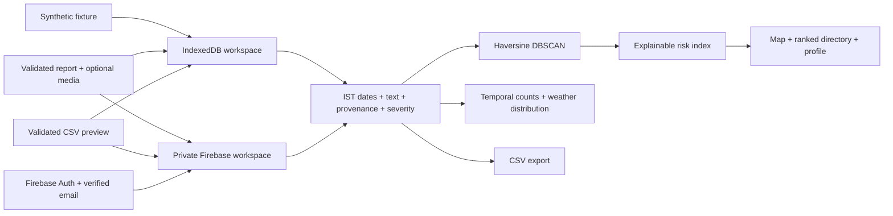

# Architecture

## Responsibilities

| File | Responsibility |
| --- | --- |
| `src/App.tsx` | Workspace lifecycle, filters, navigation, view composition |
| `src/lib/analytics.ts` | Pure clustering, distance, score, IST dates and scenario physics |
| `src/lib/validation.ts` | Field and attachment boundary validation |
| `src/lib/csv.ts` | CSV parsing, preview errors, deduplication and safe export |
| `src/lib/localStore.ts` | Atomic local record/media persistence in IndexedDB |
| `src/firebase/authContext.tsx` | Sign-in, verification, password-reset emails and sign-out |
| `src/firebase/incidentStore.ts` | Private Firestore subscription, atomic imports and authenticated evidence retrieval |
| `src/components/RiskMap.tsx` | Leaflet overlays and opt-in device geolocation |
| `firestore.rules`, `storage.rules` | Server-enforced owner access and schema/upload validation |
| `java/` | Separate, fixed-window reference CLI; no web API |

## Storage and trust

Local data stays in a versioned IndexedDB database. A transaction stores both a
report and its Blob; imports abort on conflict or capacity failure. The initial
fixture is inserted once, never on every launch. No routine startup process
deletes user data. Local workspaces are independent of Firebase accounts.

Cloud data lives at `/users/{uid}/incidents/{id}`. This is an account-private
analysis workspace, not a shared city feed. Rules require verified ownership
for both reads and writes. Reports are immutable; corrections use deletion
and resubmission. Arbitrary profile and security-alert paths are denied.
Passwords and account identity remain in Firebase Auth, not duplicate profile
collections.

Media lives at `/evidence/{uid}/{incidentId}` in Cloud Storage. It is retrieved
through authenticated `getBlob` requests rather than tokenized public download
URLs. The record references its private object path. Upload failures roll back
the object; deletion removes the object before the record so a cleanup failure
can be retried. Object URLs are revoked when the detail dialog closes.

Firestore imports use a single atomic batch of at most 400 records. Browser
workspaces are capped at 2,000 observations because the DBSCAN implementation
uses O(n²) neighbor searches. A cloud workspace that exceeds this cap through
an external client is rejected by the analysis subscription, not silently
truncated. The cap is an application limit, not a global cloud billing quota.

## Analysis semantics

Clustering uses incident coordinates, not a predeclared set of junction
statistics. The center is the mean latitude and circular mean longitude;
the displayed name is the most common location label in the group. Cluster
IDs derive from the lexicographically first incident ID and can change when
filters or clustering parameters change. Do not use them as permanent IDs.

Minimum count includes the point itself. Density-connected chains can exceed
the neighborhood radius in total diameter. Grey points are noise. Map rings
show a neighborhood radius around the center, not a hull or a risk boundary.

Scores normalize frequency to a 90-day equivalent using the selected window,
weight casualty counts, and decay recency relative to the selected period.
The reference time is min(now, selected end-of-day IST). Current-period scores
refresh every minute. Historical views are scored as of their selected end,
not as if their records just happened today.

## Scaling and validation

For larger datasets, move DBSCAN to a worker or server with a spatial index,
introduce dataset/version metadata and server-enforced quotas, and evaluate
against independently verified observations. A public reporting platform also
needs moderation, abuse prevention and operational policies. Those services
are outside this private-workspace application.

This project implements no trained hazard forecast. The stopping-distance
calculator is a separate scenario model with explicit assumptions.
